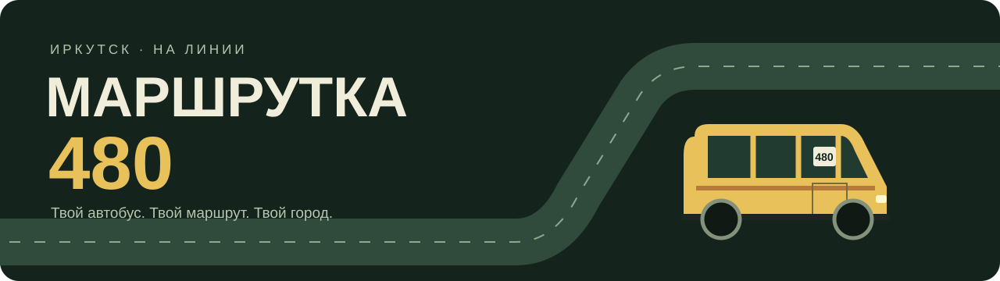

<p align="center"></p>

<p align="center"><strong>🚐 Браузерная аркада про водителя маршрутки в Иркутске</strong><br>Пассажиры, улицы, гараж и поездки с друзьями.</p>

> 🧪 **2.2 — бета.** Новая дорожная сеть и общий город уже доступны.
> Общий серверный трафик NPC ещё в работе; в этой сборке обычные машины локальные.

<p align="center"><a href="https://185.17.0.90"><strong>▶ Играть онлайн</strong></a> &nbsp;·&nbsp; <a href="#-быстрый-старт">💻 Запустить локально</a> &nbsp;·&nbsp; <a href="docs/IRKUTSK_SOURCES.md">🗺️ Источники карты</a></p>

<p align="center">   </p>

## ✨ Что ждёт на линии

| 🚦 Город и движение | 🛠️ Жизнь водителя |
| :--- | :--- |
| Реальная сеть улиц и **297 остановок** на шести линиях | Гараж, улучшения и пять моделей автобусов |
| Связанные перекрёстки и выбор конкретного съезда | Пассажиры, выручка, репутация и жалобы |
| Схема города и игроки на карте по **M** | Сюжетные главы, ДПС и погони |
| **Общий город** с гостевым входом в один клик | Карьера сохраняется в браузере |

## 🗺️ Иркутск и маршруты

| Линия | Направление |
| :---: | :--- |
| **480** | Аэропорт ↔ Луговое |
| **80** | Областная больница → вокзал → аэропорт → Областная больница |
| **33** | Центральный рынок ↔ Батарейная |
| **83** | Радужный ↔ Центральный рынок |
| **90** | Аэропорт → плотина ГЭС → левый берег → Аэропорт |
| **Т4** | Сквер Кирова ↔ Аэропорт |

🛣️ **38 885 узлов и 48 111 дорожных отрезков** из OpenStreetMap: центр,
жилые районы, Ново-Ленино, Батарейная и Луговое. Сохраняются изгибы дорог,
одностороннее движение и доступные ограничения поворотов.
Остановки и спорные участки сверены с картой **2ГИС** в браузере.
Разметка учитывается там, где она есть в открытых данных; оформление дорог
и застройка остаются аркадными.

Карта, текущая улица и маршрут используют общий граф. Поворот ведёт на связанный
участок дороги; название следующей улицы не выбирается случайно.

📚 [Происхождение данных и ограничения точности →](docs/IRKUTSK_SOURCES.md)

## 🎮 Управление

| Клавиши | Действие |
| :--- | :--- |
| **W / ↑** | Газ |
| **S / ↓** | Тормоз и задний ход |
| **A / D / ← / →** | Руль, перестроение и поворот |
| **Пробел** | Гудок; в меню — выехать в рейс |
| **P** | Пауза |
| **M** или нажатие на миникарту | Открыть / закрыть обзор маршрута |
| **Q / E** или нажатие на строку съездов | Выбрать конкретную дорогу на следующем перекрёстке |
| **Enter** | Купить или выбрать выделенный пункт меню |

📱 На телефоне доступны кнопки управления под игровым экраном.
Для поворота прижмись к нужной полосе у перекрёстка и удерживай направление.
После выбора съезда через **Q / E** продолжай движение: автобус выполнит его
в общем узле дорог. Если съехал с линии, подсказка укажет путь обратно по улицам.

## 🌍 Поехать вместе

1. Открой [игру](https://185.17.0.90) и нажми **«Общий город»**.
2. Гостевой позывной выдаётся автоматически; если ты уже вошёл, используется твой аккаунт.
3. Нажми **«В РЕЙС»** и встречай других водителей на улицах Иркутска.

В общем городе нет кода приглашения и заданного лимита числа игроков.
Фактическая вместимость зависит от ресурсов сервера. Для отдельной компании
сохранены комнаты на **2–8 человек** через **«Сетевая игра»**.

Друг может присоединиться к уже начавшейся поездке. Его автобус виден на дороге,
миникарте и большой схеме города. При обрыве связи свой рейс продолжается,
а подключение восстанавливается. Вход в общий город не сбрасывает текущую смену.

> 💡 Сервер передаёт положение и состояние автобусов, гудки и общую фазу светофоров.
> Пассажиры, NPC, сюжет и заработок рассчитываются локально.
> Личная выручка не попадает в соревновательную таблицу.

## 🚀 Быстрый старт

### 🧳 Одиночная игра — без установки

Открой корневой **`index.html`** в браузере. Сборка и npm не нужны.
Для GitHub Pages публикуй корень ветки `main`.

### 🖥️ Сервер с сетевой игрой

Понадобится **Python 3.12+**.

<details><summary><strong>🪟 Windows · PowerShell</strong></summary>

```powershell
cd server
python -m venv .venv
.venv\Scripts\python -m pip install -r requirements.txt
Copy-Item .env.example .env
.venv\Scripts\python run.py
```

</details>

<details><summary><strong>🐧 Linux / macOS</strong></summary>

```bash
cd server
python3 -m venv .venv
.venv/bin/pip install -r requirements.txt
cp .env.example .env
.venv/bin/python run.py
```

</details>

После запуска открой **http://127.0.0.1:8000**.

💾 Аккаунты хранятся в SQLite, карьера — в `localStorage` браузера.
Сервер запускается одним процессом: состояние комнат находится в памяти.

## 🧰 Для разработчиков

```text
marshrutka/
├── index.html           # Офлайн-игра и GitHub Pages
├── js/                  # Игровой движок, улицы и маршруты
├── web/                 # Серверный клиент с тем же движком
├── server/
│   ├── backend/         # FastAPI, WebSocket, аккаунты и SQLite
│   ├── deploy/          # systemd, nginx и Caddy
│   └── scripts/         # Резервное копирование
├── tests/               # Проверки движка и интеграции
└── docs/                # Протокол, источники карты и развёртывание
```

<details><summary><strong>🔎 Команды проверок</strong></summary>

География и игровой цикл:

```bash
node tests/city_topology.test.js
```

Сервер — из папки `server`, после установки `requirements-dev.txt`:

```bash
python -m unittest discover -s tests -v
```

Браузерная интеграция — из корня проекта, с установленным Chrome:

```bash
python -m pip install -r requirements-browser.txt
python tests/browser_smoke.py
python tests/browser_cache_update.py
```

Артефакты локальных проверок сохраняются в игнорируемой папке `test-results/`.

</details>

| Документ | Что внутри |
| :--- | :--- |
| [🚀 Развёртывание](server/README.md) | Запуск и настройка сервера |
| [🔌 Сетевой протокол](docs/PROTOCOL.md) | HTTP API и сообщения WebSocket |
| [🗺️ Источники географии](docs/IRKUTSK_SOURCES.md) | Маршруты, данные карты и ограничения |
| [📄 Лицензия](LICENSE) | MIT для исходного кода |

Данные дорог: **© OpenStreetMap contributors**,
[ODbL 1.0](https://www.openstreetmap.org/copyright).

---

<p align="center"><strong>🚐 Следующая остановка — твоя.</strong><br>Для поездок по Иркутску, на компьютере и телефоне.</p>
